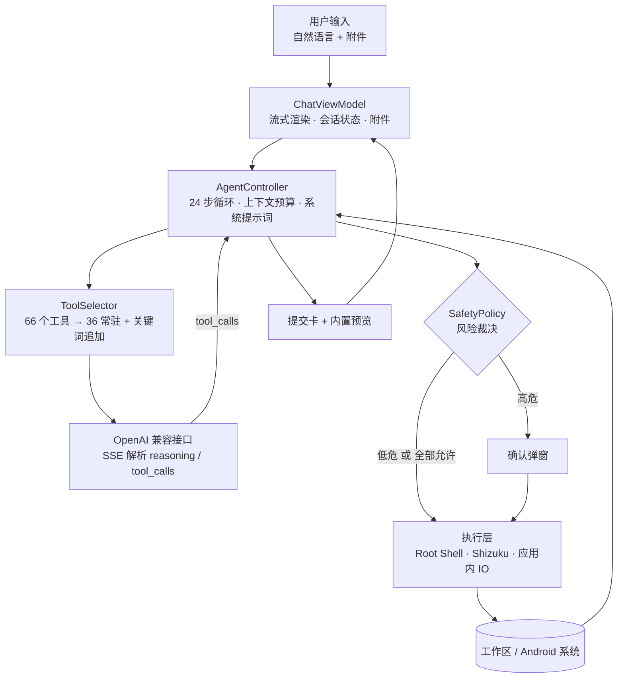

<div align="center">

# PhoneAgent

**跑在手机里的 AI Agent —— 说一句话，让大模型替你动手**

不需要服务器，不需要电脑，不需要常驻 ADB。
装一个 APK，授权 Shizuku 或 Root，填一个模型 Key，能力就长在设备上。

[](https://github.com/wenweiqi114514wenweiqi-ux/Phone-Agent/releases)
[](https://developer.android.com)
[](https://kotlinlang.org)
[](https://developer.android.com/jetpack/compose)
[](#能力清单)
[](LICENSE)

[快速开始](#快速开始) · [能力清单](#能力清单) · [工作原理](#工作原理) · [权限与安全](#权限与安全) · [常见问题](#常见问题)

</div>

---

## 它是什么

PhoneAgent 是一个**完全运行在 Android 手机本地**的通用 AI Agent。你说「把这周的销售表汇总成一份带图表的报告」，它会自己拆解步骤、挑选工具、执行命令、读写文件，最后把成品卡片放回聊天窗，点开就能预览。

它与「套壳聊天 App」的区别只有三点：

| 关注点 | PhoneAgent 的做法 |
|---|---|
| **能做事，而不只是能聊** | 66 个工具覆盖文件、Office、网络、截图点击、应用管理、系统设置，由模型自主编排多步调用 |
| **权限在你手里** | 执行通道二选一：Root（Magisk / KernelSU）优先，Shizuku 回退；三档安全策略可随时收紧 |
| **产物落在手机里** | 生成的 docx / xlsx / pptx 不经过任何服务器，直接写入工作区并在应用内渲染预览 |

> [!NOTE]
> 模型只负责「思考」。真正的读写、执行、截图都发生在你的设备上；对话内容通过你填写的 Base URL 发往你选择的模型服务商（DeepSeek、豆包 / 火山方舟、通义千问、Ollama、自建网关均可）。

---

## 亮点

| 维度 | 能力 | 说明 |
|---|---|---|
| **多步编排** | 单轮最多 24 步 | 自动拆解任务、连续调用工具；消息中带编号步骤时自动收拢为任务清单 |
| **会话工作区** | 一会话一目录 | 每个会话默认独立目录 `PhoneAgent/<32位hex>/`，附件与产物各自归位；命名工作区可跨会话共享 |
| **原生 Office** | 纯 Kotlin 生成与解析 | `doc_write` / `sheet_write` / `ppt_write` 直接写 OOXML，不联网、不依赖第三方库 |
| **内置预览** | 离线渲染常见格式 | 文本、Markdown、HTML、图片、docx / xlsx / pptx 本地渲染，文件不上传 |
| **能操作界面** | 截图、点击、滑动、输入 | 基于 shell `input` 与 `screencap`，配合 OCR 与图像理解做屏幕级操作 |
| **长期记忆** | 本机检索 + 防串扰 | 记忆存在 Room 数据库，按相关度注入提示词；仅在有时间线索时检索，避免污染当前对话 |

---

## 工作原理



一次任务的完整生命周期：

1. **理解** — 用户消息连同系统提示词、工作区路径、可用工具清单一起下发，模型返回流式正文与工具调用。
2. **裁剪** — `ToolSelector` 始终下发 36 个高频工具，其余按关键词（安装、截屏、设置等）动态追加，降低每轮 token 开销；自定义工具与正文点名的工具始终保留。
3. **裁决** — 每次调用先过 `SafetyPolicy`：低危直接执行，高危按档位弹窗确认，用户拒绝则回填错误让模型换路。
4. **执行** — 由 `ShizukuExecutor` 走 Root / Shizuku 通道，或走应用内文件 API 读写工作区。
5. **交付** — 产物经「提交前体检」（0 字节、构建中间件、结构残缺的 docx / xlsx / pptx 一律拒收）后生成提交卡；卡片只记录真实路径，不复制文件占空间。

---

## 能力清单

62 个系统与文件工具 + 4 个会话工具，按用途分为八组：

| 分组 | 数量 | 代表工具 | 典型场景 |
|---|---:|---|---|
| 文件系统 | 20 | `file_list` `file_write` `file_grep` `file_zip` | 遍历目录、批量改写、全文检索、打包压缩 |
| Office 文档 | 5 | `doc_write` `sheet_write` `ppt_write` `sheet_read` | 生成报告 / 表格 / 演示稿，回读 xlsx 与 docx |
| 网络 | 7 | `http_get` `http_post` `web_fetch` `file_download` | 抓取网页、调用接口、断网诊断（ping / dns / netstat） |
| 图像 | 2 | `ocr_image` `image_describe` | 离线中文 OCR（ML Kit）、图片内容理解 |
| 屏幕交互 | 6 | `screencap` `input_tap` `input_swipe` `input_text` | 截图、点击、滑动、长按、输入、按键 |
| 应用管理 | 8 | `pm_install` `pm_uninstall` `pm_clear` `am_start` | 安装卸载、清数据、禁用、启动与广播 |
| 系统与 Shell | 14 | `shell_exec` `dumpsys` `logcat` `sys_battery` | 任意命令、系统诊断、属性与设置读写、重启 |
| 会话与交付 | 4 | `submit_file` `ask_user` `memory_save` | 交付文件卡片、反问澄清、写入长期记忆 |

<details>
<summary><b>展开查看全部 66 个工具</b></summary>

```
文件系统 (20)
  file_list  file_mkdir  file_touch  file_copy  file_move
  file_cat   file_write  file_append file_grep  file_tail
  file_stat  file_du     file_wc     file_base64
  file_find  file_chmod  file_remove
  file_zip   file_unzip  file_zip_list

Office 文档 (5)
  doc_write  doc_extract_text  sheet_write  sheet_read  ppt_write

网络 (7)
  http_get  http_post  web_fetch  file_download
  ping      dns_lookup  netstat

图像 (2)
  ocr_image  image_describe

屏幕交互 (6)
  screencap  input_tap  input_swipe  input_longpress  input_text  input_keyevent

应用管理 (8)
  pm_list_packages  pm_install  pm_uninstall  pm_clear  pm_disable
  am_start  am_force_stop  am_broadcast

系统与 Shell (14)
  shell_exec  dumpsys  logcat  reboot
  settings_get  settings_put  settings_put_global  set_system_setting
  sys_battery  sys_df  sys_free  sys_getprop  sys_ip  sys_ps

会话与交付 (4)
  submit_file  ask_user  memory_save  set_keepalive
```

</details>

---

## 快速开始

### 一、直接安装

1. 下载并安装 APK（Android 8.0 / minSdk 26 及以上）。
2. 授权执行通道：有 Root 直接授权；无 Root 则安装 [Shizuku](https://shizuku.rikka.app/)，用 adb 启动一次服务后在应用内授权。
3. 授予「所有文件访问权限」，否则工作区位于 `/storage/emulated/0` 时预览读不到文件。
4. 进入 **设置 → 模型与接入**，填写 Base URL、API Key、模型名，选好工作区目录即可开始。

### 二、从源码构建

前置：**JDK 17** + **Android SDK**（compileSdk 36 / build-tools 35.0.0）。

```bash
# 1. 拉取源码
git clone https://github.com/wenweiqi114514wenweiqi-ux/Phone-Agent.git
cd Phone-Agent

# 2. 指向本机 SDK（该文件不入库）
echo "sdk.dir=/path/to/Android/Sdk" > local.properties

# 3. 打包 debug
./gradlew assembleDebug
# 产物：app/build/outputs/apk/debug/app-debug.apk
```

> [!TIP]
> 首次构建需要联网拉取 Gradle 与依赖。若要混淆上架，请先替换 `app/build.gradle.kts` 里的 release 签名——当前沿用 debug 签名，目的是让新版本能覆盖安装旧版本并保留数据。

---

## 权限与安全

PhoneAgent 以较高权限运行，因此把「要不要执行」交给你决定：

| 档位 | 行为 | 适合场景 |
|---|---|---|
| **全部允许** `ALLOW_ALL` | 所有工具调用直接执行 | 自有测试机、可信脚本 |
| **高危确认** `CONFIRM_HIGH` | 高危工具弹窗确认，低危静默执行（**默认**） | 日常使用 |
| **全部确认** `CONFIRM_ALL` | 任何调用都要手动放行 | 首次试用、陌生任务 |

与之配套的还有几层约束：

- **路径约束**：文件工具的相对路径按当前工作区解析，越界读写被拦截；`shell_exec` 默认进入当前工作区，但显式绝对路径仍可访问外部（硬沙箱尚未实现）。
- **提交前体检**：0 字节、构建中间件、结构残缺的 Office 文件不生成交付卡。
- **工具级风险标注**：`ToolRisk.HIGH` 覆盖卸载、清数据、重启、`shell_exec` 等破坏性操作。
- **变更可追溯**：运行日志分级记录，软件问题与环境权限问题分开呈现。

> [!WARNING]
> 本应用会在设备上执行命令、读写文件、安装或卸载应用。请仅在自己的设备上使用，并保持「高危确认」或更严格的策略。因误操作导致的数据丢失或设备异常，后果由使用者自行承担。

---

## 项目结构

```
Phone-Agent/
├── app/src/main/
│   ├── java/com/phoneagent/
│   │   ├── agent/      AgentController：多步循环、工具裁决、工作区、提示词、提交卡
│   │   ├── llm/        OpenAI 兼容客户端（SSE 流式解析、可取消）
│   │   ├── tools/      工具注册表、参数解析、安全策略、按意图裁剪
│   │   ├── exec/       Root / Shizuku 执行器；Office 读写与结构校验
│   │   ├── data/       Room 实体与迁移、设置、会话工作区、更新检测、旧附件迁移
│   │   ├── memory/     长期记忆：检索、写入护栏、过期结论过滤
│   │   ├── ui/         chat / preview / settings / sessions / artifacts（Compose）
│   │   └── util/       运行日志、存储与权限入口
│   ├── assets/         Office 预览 bundle、Python 3.14 测试组件（arm64）
│   └── res/            图标与主题资源
├── office-preview/     把 Universal File Preview 打成单文件 bundle 的构建工程
├── docs/               技术方案书、工具清单、系统提示词、发布说明
└── gradle/             版本目录与 wrapper
```

代码规模：**80 个 Kotlin 文件、约 2.1 万行**，全项目文本代码约 2.42 万行。

---

## 技术栈

| 层 | 选型 |
|---|---|
| 语言 / UI | Kotlin 2.0.21 + Jetpack Compose（Material 3） |
| 数据 | Room 2.6.1（SQLite），迁移带 schema 自校验 |
| 网络 | OkHttp 4.12 + 手写 SSE 流式解析（含 `reasoning_content` 与 `tool_calls` 增量聚合） |
| 执行 | Shizuku API 13.1.5 + Root shell |
| Office | 纯 Kotlin 写 docx / xlsx / pptx（ZIP + OOXML），预览用 Universal File Preview |
| 图像 | ML Kit 中文文字识别（离线） |
| 架构 | 单 Activity + Compose，ViewModel + StateFlow，手写 DI 容器 |

---

## 版本

当前 **1.0.16**（versionCode 90）。本版重点：

- **旧附件自动迁移** — 首次启动把旧会话附件搬到对应会话目录，重名追加序号，原文件保留
- **删除会话即清文件** — 删除弹窗显示目录占用，可勾选「同时删除本会话文件」，默认勾选
- **会话存储管理** — 设置页新增占用统计与「清理无主会话目录」
- **口语化工具命中** — 「截屏 / 点一下 / 划一下 / 装一下」也能选对工具组
- 延续 beta：会话独立目录、流式收尾兜底、36 个核心工具按需下发

详细变更见 [docs/RELEASE_NOTES_v1.0.16.md](docs/RELEASE_NOTES_v1.0.16.md)，完整历史见 [Releases](https://github.com/wenweiqi114514wenweiqi-ux/Phone-Agent/releases)。

---

## 已知限制

- **不做无障碍自动化**：无法逐屏点按第三方 App 界面，跨应用操作依赖 HTTP、网页抓取、OCR 或 shell。
- **Office 能力有边界**：复杂排版、图表、公式、母版样式支持有限，重要文档建议再用办公软件复核。
- **旧格式需转换器**：`.doc` / `.ppt` 的生成仍依赖 LibreOffice 等外部转换。
- **PDF 暂无内置渲染**，音视频交由应用内播放器。
- **测试组件仅 arm64**：内置 Python 3.14，FFmpeg 尚未提供。
- **Beta 与正式版同包名**（`com.phoneagent`），无法共存，只能升级到更高 versionCode。

---

## 常见问题

<details>
<summary><b>必须 Root 才能用吗？</b></summary>

不必。没有 Root 时用 Shizuku 即可获得大部分 shell 能力，差异主要集中在少数需要系统权限的写入操作。

</details>

<details>
<summary><b>支持哪些模型？</b></summary>

任何兼容 OpenAI Chat Completions 协议的接口都可以，包括 DeepSeek、豆包 / 火山方舟、通义千问、Ollama 本地部署以及自建网关。只需填 Base URL、API Key 与模型名。

</details>

<details>
<summary><b>对话内容会被上传吗？</b></summary>

只会发送到你配置的模型服务商，项目本身没有中转服务器。会话、记忆、生成的文件全部保存在本机。

</details>

<details>
<summary><b>为什么有时工具「选不中」？</b></summary>

发给模型的工具清单会按关键词裁剪。若某个工具没被命中，可以在话里直接点名（如「用 screencap 截个图」），点名工具一定会保留。

</details>

<details>
<summary><b>构建报错提示找不到 SDK？</b></summary>

在项目根目录创建 `local.properties`，写入 `sdk.dir=你的 Android SDK 绝对路径`，再重新执行 `./gradlew assembleDebug`。

</details>

---

## 文档

| 文档 | 内容 |
|---|---|
| [docs/技术方案书.md](docs/技术方案书.md) | 整体设计、模块划分与关键决策 |
| [docs/tools.json](docs/tools.json) | 工具定义示例与参数结构 |
| [docs/system_prompt.md](docs/system_prompt.md) | 系统提示词与行为约束 |
| [docs/command_map.md](docs/command_map.md) | 工具到底层命令的映射 |
| [docs/RELEASE_NOTES_v1.0.16.md](docs/RELEASE_NOTES_v1.0.16.md) | 当前版本变更说明 |

---

## 反馈与许可

Issue、建议与 Bug 反馈：[GitHub Issues](https://github.com/wenweiqi114514wenweiqi-ux/Phone-Agent/issues)（请附版本号与运行日志中的错误条目）。

邮箱：2483807557@qq.com　·　Telegram：[@Phone_Agent_1](https://t.me/Phone_Agent_1)

本项目与其它同名项目无关，代码与实现均为独立完成。

本项目基于 [MIT License](LICENSE) 开源 © 2026 PhoneAgent contributors。
内置预览使用 [Universal File Preview](https://github.com/dukeofwest/universal-file-preview)（MIT），详见 [NOTICE](NOTICE)。
